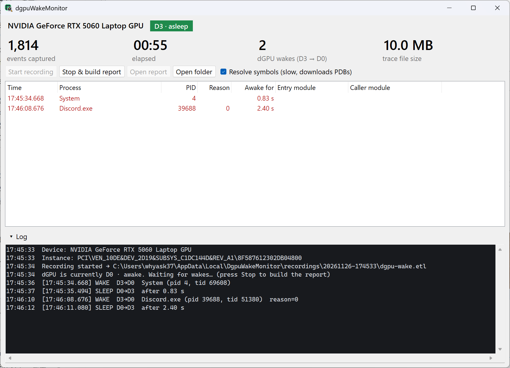

# dgpuWakeMonitor

Finds out **which app keeps waking up your laptop's graphics card** (NVIDIA/AMD), draining the battery.



## Usage

Is your laptop's battery draining faster than it should, or are its fans spinning with nothing open?
A common cause is an app that keeps waking up the NVIDIA/AMD graphics chip, which is supposed to sleep
until you start a game. This tool shows you which app it is.

1. Run `dgpuWakeMonitor.exe`. Click **Yes** when Windows asks for permission.
2. Recording starts automatically. Use your laptop as usual.
   The badge next to the GPU name shows whether it's **asleep** or **awake** right now.
3. Every time something wakes the GPU, a new row appears showing **which app** did it and **how long** the GPU stayed awake.
4. When you've seen enough, click **Stop & build report**. A detailed report opens in your browser.

Tips:

- Leave it running for a few minutes, or as long as it takes for the problem to happen again.
- **Open folder** shows where your recordings are saved. Each recording gets its own folder.
- If you close the window while it's still recording, it asks whether to build the report first.

In the screenshot above, it's `Discord.exe`, and that was the real cause on that laptop.
Other apps you'll often see:

- **`chrome.exe`** (and other browsers): fix it by making the app use only the integrated GPU.
  Open **Settings → System → Display → Graphics**, pick the app, and set it to **Power saving**.
  The same setting is worth trying for `Discord.exe` and other apps.
- **`System`**: Windows itself woke the GPU. Live with it: you can't uninstall Windows.
- **`nvcontainer.exe`**: NVIDIA's background service. If it only shows up now and then, live with it.
  If it wakes the GPU often, something may be wrong. You could try disabling the NVIDIA container service,
  but I don't recommend it.

## Advanced

For where recordings are saved, symbol resolution, the command line, and how wakes are detected, see [README_ADVANCED.md](README_ADVANCED.md).

## Build

Requires the .NET 9 SDK and Windows 10/11 x64.

Single-file executable (recommended): produces `publish\dgpuWakeMonitor.exe`, about 7.8 MB:

```powershell
dotnet publish src/DgpuWakeMonitor -c Release -o publish
```

It needs the [.NET 9 Desktop Runtime](https://dotnet.microsoft.com/download/dotnet/9.0) on the target machine.
For a fully standalone exe that needs no runtime (about 150 MB), add `--self-contained true`.
TraceEvent's native helpers (`msdia140.dll`, `KernelTraceControl.dll`) are bundled inside the exe and
extracted to a temp folder on first run.

Development build (multiple files under `bin\`):

```powershell
dotnet build src/DgpuWakeMonitor -c Release
```

## License

[MIT](LICENSE.txt)
